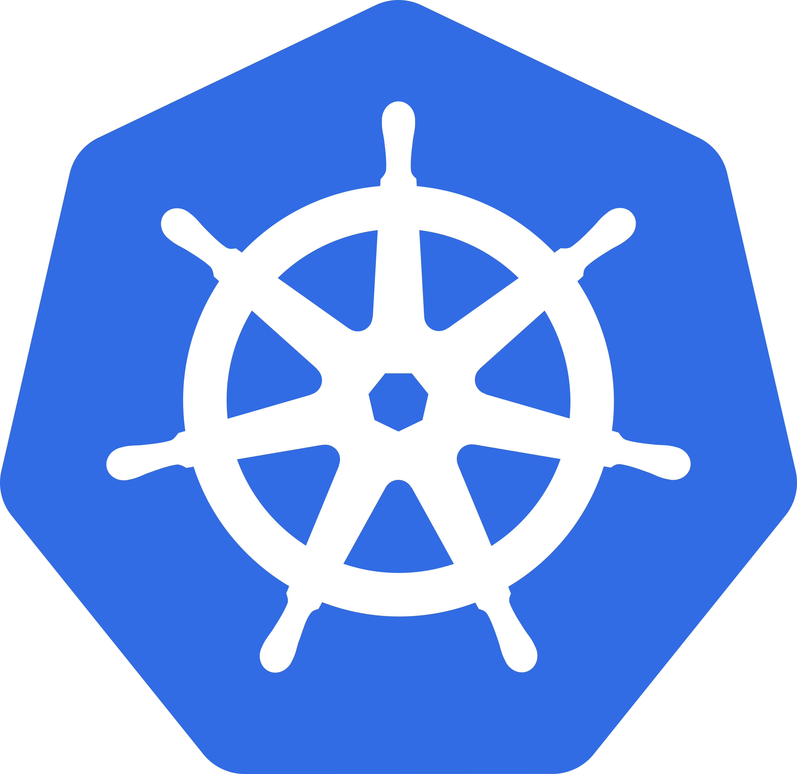

# Kubernetes 入门与日常使用

> 技术分享文档 · 面向初学者与日常使用者
> 目标：让听众从「听过 K8S」到「能独立部署、排障一个应用」
> 
> 

---

## Kubernetes 名字的由来

- **K8s** 是 **K**ubernete**s** 的缩写：首字母 K \+ 中间 8 个字母 \+ 尾字母 s

- **Kubernetes** 源自希腊语 **κυβερνήτης**（kybernētēs），意为"舵手"或"领航员"



- 这个词也是 **cybernetics（控制论）** 的词源，暗示 K8S 的核心定位——"控制、编排、导航"容器集群

## 目录

1. 为什么需要 K8S（背景与动机）

2. K8S 是什么（整体认知）

3. 核心概念（必须讲透的 5 件事）

4. 日常使用（实操核心）

5. 进阶与工程化（概览）

6. 常见问题与避坑（概览）

---

## 一、为什么需要 K8S（背景与动机）

### 1\.1 部署演进史

```
物理机部署  →  虚拟机部署  →  容器化部署  →  容器编排
(2010前)      (2010后)      (2013 Docker)  (2017+ K8S)
```

|阶段|特点|痛点|
|---|---|---|
|物理机|一台机器跑一个应用，资源利用率低|隔离差、扩容慢、浪费资源|
|虚拟机|通过 Hypervisor 切分资源|启动慢（分钟级）、镜像大（GB）、依赖 OS|
|容器|进程级隔离、镜像秒级启动|多机管理难、故障恢复靠人|
|容器编排|自动调度、自愈、弹性|学习曲线陡，但一劳永逸|

#### K8S 发展时间线

- Google 内部的前身项目叫 **Borg**（《星际迷航》中的半机械人种族），K8S 是 Borg 的开源继任者

- 2014：Google 开源 Borg 系统的衍生项目 Kubernetes

- 2015：v1\.0 发布，捐赠给 CNCF（云原生计算基金会）

- 2018：成为 CNCF 第一个"毕业"项目

- 2023：v1\.28，已是容器编排事实标准

- 当前：主流云厂商均提供托管 K8S 服务（EKS/GKE/AKS/ACK/TKE）

### 1\.2 容器化带来的新问题

Docker 解决了「应用打包与运行环境一致」，但当容器数量从几个变成几百上千个时，新的问题出现：

- **调度问题**：1000 个容器怎么分配到 50 台机器？哪台机器资源够？

- **故障恢复**：一台机器宕机了，上面的容器谁来重启？迁到哪？

- **服务发现**：容器 IP 是动态的，调用方怎么找到目标？

- **滚动发布**：如何不停机升级 50 个副本？

- **弹性伸缩**：流量来了怎么自动扩容？

**手动做这些事 = 灾难。** 于是需要编排工具。

### 1\.3 编排工具对比

|工具|定位|优劣|
|---|---|---|
|Docker Compose|单机多容器编排|简单易用，但只能单机|
|Docker Swarm|多机集群|集成 Docker，但功能弱、生态小|
|Nomad|通用调度器|轻量，但容器编排能力不如 K8S|
|**Kubernetes**|容器编排平台|功能强大、生态丰富、CNCF 标准|

K8S 胜出的核心原因：**声明式 API \+ 丰富的生态 \+ 厂商中立（CNCF）\+ Google 背景**。

### 1\.4 K8S 核心能力速览

- **自动调度**：根据资源需求自动分配 Pod 到节点

- **自愈**：容器挂了自动重启，节点挂了自动迁移

- **弹性伸缩**：根据 CPU/内存/自定义指标自动扩缩容

- **滚动更新与回滚**：零停机发布，一键回滚

- **服务发现与负载均衡**：内置 DNS \+ Service 转发

- **配置与密钥管理**：ConfigMap / Secret 热更新

- **声明式 API**：描述「期望状态」，系统自动逼近

---

#### 什么时候不该用 K8S

K8S 不是银弹，以下场景建议慎重：

- 单机应用或内部工具，无多副本需求

- 团队规模小（\<5 人），没有专职运维

- 没有持续部署需求，更新频率低

- 预算有限，无法承担学习与运维成本

- 简单的静态网站或博客

> K8S 的价值在于"规模化运维"，规模不够时引入反而是负担。
> 
> 

## 二、K8S 是什么（整体认知）

### 2\.1 架构总览

K8S 是一个**主从架构**的分布式系统，分为两部分：

- **Control Plane（控制面 / Master）**：集群的"大脑"，负责决策

- **Worker Node（工作节点）**：干活的"手脚"，负责运行 Pod

### 2\.2 核心组件详解

#### Control Plane 组件

|组件|作用|关键点|
|---|---|---|
|**kube\-apiserver**|所有操作的唯一入口（REST API）|唯一直接访问 etcd 的组件；kubectl 也走它|
|**etcd**|分布式 KV 存储，存集群所有状态|强一致、Raft 协议；**集群命根子**，必须备份|
|**kube\-scheduler**|决定 Pod 调度到哪个节点|两阶段：过滤 \+ 打分|
|**kube\-controller\-manager**|运行各种控制器（Deployment、Node、Endpoint 等）|实现 Reconcile 循环|
|**cloud\-controller\-manager**|对接云厂商（LB、Volume、路由）|让 K8S 不强耦合云厂商|

#### Worker Node 组件

|组件|作用|
|---|---|
|**kubelet**|节点上的"Pod 管家"，向 API Server 上报状态，启动/停止 Pod|
|**kube\-proxy**|维护节点上的网络规则（iptables / IPVS），实现 Service 转发|
|**Container Runtime**|真正跑容器的进程，主流是 **containerd**（CRI 标准）|

### 2\.3 声明式模型（K8S 的灵魂）

**K8S 与传统脚本最大的区别：你说"想要什么"，而不是"做什么"。**

```
传统运维（命令式）：
  启动 3 个 Nginx → 写脚本 → 逐台 docker run

K8S（声明式）：
  描述 "我要 3 个 Nginx 副本" → 提交给 K8S → K8S 自动维持
```

**Reconcile 循环**：控制器不断对比「期望状态」与「实际状态」，发现差异就修正。

```
期望状态: replicas=3
实际状态: 只有 2 个 Pod 在运行（1 个挂了）

Controller 发现差异 → 自动创建 1 个新 Pod → 达到 3 个
```

这套机制带来三大好处：

- **幂等**：apply 多次结果一样

- **自愈**：异常自动恢复

- **可 GitOps**：状态可版本化、可审计

### 2\.4 K8S 分层抽象

```
应用层      │ Deployment / StatefulSet / Job / CronJob
            ─────────────────────────────────────────
服务层      │ Service / Ingress / EndpointSlice
            ─────────────────────────────────────────
配置层      │ ConfigMap / Secret / DownwardAPI
            ─────────────────────────────────────────
工作负载层  │ Pod（最小调度单元）
            ─────────────────────────────────────────
网络层      │ CNI / kube-proxy / DNS (CoreDNS)
            ─────────────────────────────────────────
存储层      │ PV / PVC / StorageClass / CSI
            ─────────────────────────────────────────
基础设施层  │ Node / Runtime / OS / 硬件
```

---

## 三、核心概念

### 3\.1 Pod —— 最小调度单元

#### 为什么不是容器？

- 容器是 Docker 的概念，K8S 不直接调度容器

- K8S 调度的最小单位是 **Pod**，一个 Pod 内可包含 1 个或多个紧密耦合的容器

- Pod 内容器**共享网络**（同 IP、同端口空间）和**存储卷**

#### Pod 的特征

|特征|说明|
|---|---|
|临时性|Pod 是临时的，随时可能被销毁重建|
|独立 IP|每个 Pod 有独立 Pod IP（集群内可路由）|
|内含容器|通常 1 主容器 \+ 0\~N 辅助容器（sidecar）|
|不直接创建|一般通过 Deployment / Job 等控制器创建|

#### 典型 YAML

```yaml
apiVersion: v1
kind: Pod
metadata:
  name: my-app
  labels:
    app: my-app
spec:
  containers:
  - name: app
    image: nginx:1.25
    ports:
    - containerPort: 80
    resources:
      requests: { cpu: 100m, memory: 128Mi }
      limits:   { cpu: 500m, memory: 256Mi }
```

#### Pod 生命周期与状态

Pod 在生命周期中会经历不同阶段（Phase）：

|Phase|含义|说明|
|---|---|---|
|Pending|已创建，等待调度|可能资源不足、镜像拉取中|
|Running|已调度且至少一个容器运行|正常状态|
|Succeeded|所有容器成功退出|Job/CronJob 常见|
|Failed|所有容器退出且至少一个失败|需查日志|
|Unknown|无法获取状态|通常节点失联|

容器级别还有三种状态：Waiting / Running / Terminated，用 `kubectl describe pod` 可查看。

排障时第一步看 `kubectl get pod` 的 STATUS 列和 `kubectl describe pod` 的 Events 段。

#### initContainers 简述

初始化容器在主容器启动前按序运行，常用于：

- 等待依赖服务就绪（如 DB 可连接）

- 初始化配置文件或数据卷

- 注册到服务发现

所有 initContainer 成功退出后才会启动主容器。任一 initContainer 失败，Pod 重启重试。

#### 无状态假设：K8S 的设计哲学

K8S 从一开始就围绕「无状态」设计。Pod 是临时的、可随时销毁重建的，K8S 的自愈、滚动更新、弹性伸缩等核心能力都建立在「Pod 随时可换」的前提上——而 Pod 可换的前提就是应用无状态。

**什么是无状态应用？**

- 不在 Pod 本地内存或磁盘保存业务数据

- 所有状态外置到数据库、缓存、对象存储等独立服务

- 任意一个 Pod 实例都能处理任意请求（对等关系）

- Pod 挂了重启后行为一致，不依赖本地遗留状态

**K8S 如何处理有状态应用？**

|场景|无状态方案|有状态方案|
|---|---|---|
|副本管理|Deployment（副本对等可互换）|StatefulSet（每个 Pod 有稳定身份）|
|存储|emptyDir（随 Pod 消失）|PV/PVC（持久化，Pod 重建后数据还在）|
|网络标识|Service（负载均衡到任意 Pod）|Headless Service（直连具体 Pod）|
|典型应用|Web API、微服务|MySQL 主从、Redis 集群、ES、ZooKeeper|

> 微服务架构和 K8S 天然契合——微服务提倡「无状态服务 \+ 状态外置」，正好对上 K8S 的设计哲学。有状态应用也能跑在 K8S 上，但需要用 StatefulSet \+ 持久化存储，复杂度显著增加。
> 
> 

### 3\.2 Deployment —— 副本控制 \+ 滚动更新

#### 解决什么问题？

裸 Pod 挂了不会自动重启，多副本管理也麻烦。Deployment 就是答案。

#### 三大核心能力

1. **副本控制**：维持指定数量的 Pod 副本

2. **滚动更新**：升级镜像时逐个替换，零停机

3. **版本回滚**：保留历史版本，一键 undo

#### 声明式示例

```yaml
apiVersion: apps/v1
kind: Deployment
metadata:
  name: my-app
spec:
  replicas: 3                    # 期望 3 个副本
  selector:
    matchLabels:
      app: my-app
  strategy:
    type: RollingUpdate          # 滚动更新策略【Recreate：非滚动，先全杀死再起】
    rollingUpdate:
      maxSurge: 1                # 最多多启 1 个
      maxUnavailable: 0          # 不允许减少
  template:                      # Pod 模板
    metadata:
      labels:
        app: my-app
    spec:
      containers:
      - name: app
        image: my-app:v1
        ports:
        - containerPort: 8080
```

#### 滚动更新原理

```
旧 ReplicaSet (v1):  P1 P2 P3         ← 3个旧版本
                    ↓ 启动 1 个新版
                    P1 P2 P3 + P4(new)
                    ↓ 逐步替换
                    P1 P2 + P4(new) + P5(new)
                    ↓
新 ReplicaSet (v2):  P4 P5 P6         ← 3个新版本
```

**Deployment 实际不直接管 Pod，而是管 ReplicaSet。** 每次 image 变化会创建新 RS，旧 RS 缩到 0 但保留，用于回滚。

#### Recreate 策略（对比 RollingUpdate）

|策略|行为|适用场景|
|---|---|---|
|RollingUpdate（默认）|逐步替换，零停机|大多数场景|
|Recreate|先全部杀掉旧 Pod，再创建新 Pod|不兼容多版本共存（如 DB schema 变更）|

Recreate 会有停机时间，慎用。

### 3\.3 Service —— 稳定访问入口

#### 解决什么问题？

Pod IP 是动态的（Pod 重建 IP 变），调用方无法稳定访问。Service 提供**固定 IP \+ 自动负载均衡**。

#### 四种类型

|类型|访问范围|典型场景|
|---|---|---|
|**ClusterIP**（默认）|集群内部|微服务间调用|
|**NodePort**|集群节点 IP \+ 端口（30000\-32767）|临时对外、测试|
|**LoadBalancer**|云厂商分配公网 LB IP|生产对外暴露|
|**Ingress**|通过域名 \+ 路径路由到 Service|HTTP\(S\) 对外（七层）|

#### 工作原理

```
客户端 → Service(ClusterIP 虚拟 IP)
         ↓
     kube-proxy 维护的转发规则 (iptables/IPVS)
         ↓
    EndpointSlice 列表 [Pod1:port, Pod2:port, Pod3:port]
         ↓
       负载均衡到具体 Pod
```

#### 示例 YAML

```yaml
apiVersion: v1
kind: Service
metadata:
  name: my-app-svc
spec:
  type: ClusterIP
  selector:
    app: my-app            # 通过 Label 关联 Pod
  ports:
  - port: 80              # Service 端口
    targetPort: 8080       # Pod 端口
```

#### Ingress 补充

Ingress 是 7 层路由（基于 HTTP 请求的域名/路径做转发），类似 Nginx。它本身不直接暴露端口，需要一个 Ingress Controller（如 nginx\-ingress、traefik）来实际处理请求。

```yaml
apiVersion: networking.k8s.io/v1
kind: Ingress
metadata:
  name: my-app-ingress
spec:
  rules:
  - host: api.example.com
    http:
      paths:
      - path: /
        pathType: Prefix
        backend:
          service:
            name: my-app-svc
            port:
              number: 80
```

访问 `http://api.example.com/` 时，Ingress Controller 会将请求转发到 `my-app-svc` 的 80 端口。

#### Service 与 Ingress 的关系

Ingress 不直接连 Pod，而是把请求转发给 Service，Service 再负载均衡到 Pod。两者是分层关系：

```
外部用户
  │
  ▼
Ingress（7层路由：按域名/路径分流）
  │
  ├── api.example.com/users  → Service A (ClusterIP)
  ├── api.example.com/orders → Service B (ClusterIP)
  └── api.example.com/static  → Service C (ClusterIP)
                                    │
                                    ▼
                              Pod × N（通过 Label Selector 关联）
```

**为什么不直接用 Service 对外暴露？**

|方式|能力|局限|
|---|---|---|
|Service \(ClusterIP\)|集群内部访问|外部进不来|
|Service \(NodePort\)|节点 IP:端口对外|端口有限\(30000\-32767\)、无域名路由|
|Service \(LoadBalancer\)|云厂商分配公网 IP|每个服务一个 LB = 一份钱|
|**Ingress**|域名/路径路由 \+ TLS \+ 多服务复用一个入口|需要 Ingress Controller|

Ingress 的价值：用一个入口（一个公网 IP）按域名和路径路由到多个 Service，省 LB 成本 \+ 支持 HTTPS \+ 支持路径分流。

**核心区别**：

|维度|Service|Ingress|
|---|---|---|
|OSI 层|4 层（IP\+端口）|7 层（HTTP 域名/路径）|
|直接关联 Pod|是（通过 Label Selector）|否（通过 Service 间接关联）|
|需要 Controller|不需要（kube\-proxy 原生支持）|需要（nginx\-ingress / traefik 等）|

> **Service 是 Pod 的访问入口，Ingress 是 Service 的访问入口。** Ingress 不替代 Service，而是在 Service 之上加了一层 7 层路由。
> 
> 

### 3\.4 ConfigMap / Secret —— 配置与密钥管理

#### 为什么要单独管理配置？

- 镜像与配置解耦：同一个镜像跑 dev/staging/prod

- 配置变更不重新打镜像

- 敏感数据需加密存储

#### ConfigMap：非敏感配置

```yaml
apiVersion: v1
kind: ConfigMap
metadata:
  name: app-config
data:
  DB_HOST: "mysql.default.svc"
  LOG_LEVEL: "info"
  config.yaml: |
    server:
      port: 8080
      timeout: 30s
```

#### Secret：敏感数据（base64 编码，非加密！）

```yaml
apiVersion: v1
kind: Secret
metadata:
  name: db-secret
type: Opaque
data:
  password: cGFzc3dvcmQxMjM=    # echo -n "password123" | base64
```

#### 注入方式（两种）

|方式|特点|适用|
|---|---|---|
|**环境变量**|启动时注入，变更需重启 Pod|简单配置|
|**Volume 挂载**|支持热更新，挂为文件|配置文件|

```yaml
spec:
  containers:
  - name: app
    env:
    - name: DB_HOST
      valueFrom:
        configMapKeyRef:
          name: app-config
          key: DB_HOST
    - name: DB_PASSWORD
      valueFrom:
        secretKeyRef:
          name: db-secret
          key: password
    volumeMounts:
    - name: config-vol
      mountPath: /etc/config
  volumes:
  - name: config-vol
    configMap:
      name: app-config
```

> ⚠️ **Secret 安全提醒**：base64 只是编码不是加密，etcd 中也是明文存储。生产环境需开启 **etcd 静态加密** 或使用外部密钥管理（Vault、云 KMS）。
> 
> 

### 3\.5 Namespace —— 逻辑隔离

#### 作用

- 在同一集群内做**逻辑分区**（按环境、按团队、按项目）

- 配合 **ResourceQuota** 限制资源用量

- 配合 **LimitRange** 限制单个 Pod 资源

- RBAC 权限可绑定到 Namespace

#### 默认 Namespace

|Namespace|用途|
|---|---|
|`default`|用户默认|
|`kube-system`|K8S 系统组件|
|`kube-public`|公共资源（集群信息）|
|`kube-node-lease`|节点心跳|

#### 示例

```yaml
apiVersion: v1
kind: Namespace
metadata:
  name: team-payment

---
apiVersion: v1
kind: ResourceQuota
metadata:
  name: quota
  namespace: team-payment
spec:
  hard:
    *# 1. 计算资源总量*
    requests.cpu: "10"             *# 所有 Pod 加起来申请的 CPU 不超过 10 核*
    requests.memory: 20Gi          *# 申请的内存不超过 20Gi*
    limits.cpu: "20"               *# 所有 Pod 加起来 limit CPU 不超过 20 核*
    limits.memory: 40Gi            *# limit 内存不超过 40Gi*

    *# 2. 资源对象数量*
    pods: "20"                     *# 最多 20 个 Pod*
    services: "10"                 *# 最多 10 个 Service*
    configmaps: "30"               *# 最多 30 个 ConfigMap*
    secrets: "20"                  *# 最多 20 个 Secret*
    persistentvolumeclaims: "10"   *# 最多 10 个 PVC*
    
    *# 3. 按类型限制*
    services.loadbalancers: "2"    *# LoadBalancer 类型 Service 最多 2 个（贵！）*
    services.nodeports: "5"        *# NodePort 最多 5 个*
```

---

## 四、日常使用（实操核心）

### 4\.1 本地环境搭建

|工具|特点|推荐场景|
|---|---|---|
|**minikube**|单节点虚拟机，老牌稳定|入门学习https://minikube\.kubernetes\.ac\.cn/docs/start|
|**kind**|Docker in Docker，启动快|CI、轻量测试|
|**k3d**|k3s 容器化，资源占用极低，k3s in DockerRancher 自己的命名，官方解释是"比 k8s 少 5 个字母的轻量版"（k8s 有 10 字符，k3s 有 3 字符，差 5，所以中间用 3）|本地开发|
|**Docker Desktop**|内置 K8S，一键开启|Mac/Win 开发|

### 4\.2 kubectl 必备命令（高频）

```bash
# 查看资源
kubectl get pods                        # 列出 Pod
kubectl get pods -o wide                # 含 IP/节点
kubectl get pods -A                     # 所有命名空间
kubectl get all                         # 所有资源

# 详情与排障
kubectl describe pod <name>            # 事件 + 状态详情（排障利器）
kubectl logs <pod>                      # 查看日志
kubectl logs -f <pod> --tail=100       # 实时跟踪日志
kubectl logs <pod> -c <container>      # 指定容器
kubectl exec -it <pod> -- bash         # 进入容器

# 部署与更新
kubectl apply -f deploy.yaml           # 声明式部署（推荐）
kubectl apply -f ./manifests/ -R       # 批量
kubectl delete -f deploy.yaml          # 删除
kubectl scale deploy my-app --replicas=5    # 扩缩容

# 滚动更新
kubectl set image deploy/my-app app=my-app:v2    # 更新镜像
kubectl rollout status deploy/my-app            # 查看更新状态
kubectl rollout history deploy/my-app           # 查看历史版本
kubectl rollout undo deploy/my-app              # 回滚到上一版
kubectl rollout undo deploy/my-app --to-revision=3   # 回滚到指定版本

# 标签与选择
kubectl get pods -l app=my-app,env=prod
kubectl label pod <name> env=test

# 配置管理
kubectl create configmap app-config --from-file=config.yaml
kubectl create secret generic db-secret --from-literal=password=xxx
```

#### 其他常用命令

```bash
# 上下文与命名空间切换
kubectl config get-contexts                            # 查看所有上下文
kubectl config use-context prod-cluster                 # 切换集群
kubectl config set-context --current --namespace=dev    # 切换命名空间

# 本地端口转发（调试神器）
kubectl port-forward svc/my-svc 8080:80                 # 本地 8080 → Service 80
kubectl port-forward pod/my-pod 8080:80                 # 直连 Pod

# 验证 YAML 语法（不实际提交）
kubectl apply -f deploy.yaml --dry-run=client
```

### 4\.3 实战演练：从零一步步部署完整应用

本节用一个完整例子串起第三章的所有资源：Namespace → ConfigMap → Secret → Pod → Deployment → Service。每个资源都给出 YAML、执行命令、预期输出，照着一步步敲即可。

**前置准备**：本地启动 minikube（或 kind），确认环境就绪：

```bash
minikube start
kubectl version --short        # Client 和 Server 版本都能显示即 OK
kubectl get nodes              # 看到 STATUS 为 Ready 的节点即集群就绪
```

#### 第 1 步：创建 Namespace

写 `01-namespace.yaml`：

```yaml
apiVersion: v1
kind: Namespace
metadata:
  name: demo
```

执行与验证：

```bash
kubectl apply -f 01-namespace.yaml
# 输出：namespace/demo created

kubectl get ns demo
# NAME   STATUS   AGE
# demo   Active   5s
```

#### 第 2 步：创建 ConfigMap

写 `02-configmap.yaml`：

```yaml
apiVersion: v1
kind: ConfigMap
metadata:
  name: app-config
  namespace: demo
data:
  APP_ENV: "development"
  LOG_LEVEL: "debug"
```

执行与验证：

```bash
kubectl apply -f 02-configmap.yaml
# 输出：configmap/app-config created

kubectl describe configmap app-config -n demo
# Data 段能看到 APP_ENV 和 LOG_LEVEL 的键值
```

#### 第 3 步：创建 Secret

先生成 base64 编码：

```bash
echo -n "S3cretPass" | base64
# 输出：UzNjcmV0UGFzcw==
```

写 `03-secret.yaml`：

```yaml
apiVersion: v1
kind: Secret
metadata:
  name: db-secret
  namespace: demo
type: Opaque
data:
  password: UzNjcmV0UGFzcw==
```

执行与验证：

```bash
kubectl apply -f 03-secret.yaml
# 输出：secret/db-secret created

kubectl get secret db-secret -n demo
# NAME        TYPE     DATA   AGE
# db-secret   Opaque   1      5s

# 验证可解码还原
c
# 输出：S3cretPass
```

#### 第 4 步：创建 Pod（裸 Pod，学习用）

写 `04-pod.yaml`（注入 ConfigMap 和 Secret）：

```yaml
apiVersion: v1
kind: Pod
metadata:
  name: my-pod
  namespace: demo
  labels:
    app: demo
spec:
  containers:
  - name: nginx
    image: nginx:1.25
    env:
    - name: APP_ENV
      valueFrom:
        configMapKeyRef:
          name: app-config
          key: APP_ENV
    - name: DB_PASSWORD
      valueFrom:
        secretKeyRef:
          name: db-secret
          key: password
```

执行与验证（重点看状态流转）：

```bash
kubectl apply -f 04-pod.yaml
# 输出：pod/my-pod created

kubectl get pod my-pod -n demo -w
# NAME     READY   STATUS              RESTARTS   AGE
# my-pod   0/1     Pending             0          2s      <- 调度中
# my-pod   0/1     ContainerCreating   0          5s      <- 拉镜像、创建容器
# my-pod   1/1     Running             0          15s     <- 成功（Ctrl+C 退出 watch）

# 验证环境变量已注入
kubectl exec -it my-pod -n demo -- env | grep -E "APP_ENV|DB_PASSWORD"
# APP_ENV=development
# DB_PASSWORD=S3cretPass

# 查看容器日志
kubectl logs my-pod -n demo --tail=5
```

排查：如果一直 Pending 或 ImagePullBackOff：

```bash
kubectl describe pod my-pod -n demo
# 看底部 Events 段：镜像名错误？资源不足？仓库不通？
```

#### 第 5 步：创建 Deployment

写 `05-deployment.yaml`：

```yaml
apiVersion: apps/v1
kind: Deployment
metadata:
  name: web
  namespace: demo
spec:
  replicas: 3
  selector:
    matchLabels:
      app: web
  template:
    metadata:
      labels:
        app: web
    spec:
      containers:
      - name: nginx
        image: nginx:1.25
        ports:
        - containerPort: 80
        envFrom:
        - configMapRef:
            name: app-config
        resources:
          requests: { cpu: 100m, memory: 128Mi }
          limits:   { cpu: 500m, memory: 256Mi }
        readinessProbe:
          httpGet: { path: /, port: 80 }
          initialDelaySeconds: 5
          periodSeconds: 5
```

执行与验证：

```bash
kubectl apply -f 05-deployment.yaml
# 输出：deployment.apps/web created

kubectl get deployment web -n demo
# NAME   READY   UP-TO-DATE   AVAILABLE   AGE
# web    3/3     3            3           30s     <- READY 3/3 即成功

kubectl get pods -n demo -l app=web
# NAME                   READY   STATUS    RESTARTS   AGE
# web-6b7f8c5d4-abcde    1/1     Running   0          30s
# web-6b7f8c5d4-fghij    1/1     Running   0          30s
# web-6b7f8c5d4-klmno    1/1     Running   0          30s
```

体验自愈能力——删掉一个 Pod，看它自动重建：

```bash
kubectl delete pod web-6b7f8c5d4-abcde -n demo
# pod "web-6b7f8c5d4-abcde" deleted

kubectl get pods -n demo -l app=web
# 新 Pod 自动创建，副本数回到 3 个
```

#### 第 6 步：创建 Service 并访问

写 `06-service.yaml`：

```yaml
apiVersion: v1
kind: Service
metadata:
  name: web-svc
  namespace: demo
spec:
  type: NodePort
  selector:
    app: web
  ports:
  - port: 80
    targetPort: 80
    nodePort: 30080
```

执行与验证：

```bash
kubectl apply -f 06-service.yaml
# 输出：service/web-svc created

kubectl get svc web-svc -n demo
# NAME      TYPE       CLUSTER-IP     EXTERNAL-IP   PORT(S)        AGE
# web-svc   NodePort   10.96.58.113   <none>        80:30080/TCP   5s

# 关键排查点：确认 Endpoints 已关联 Pod（为空说明 Label 没匹配上）
kubectl get endpoints web-svc -n demo
# NAME      ENDPOINTS                                  AGE
# web-svc   10.244.0.5:80,10.244.0.6:80,10.244.0.7:80   5s
```

三种访问方式：

```bash
# 方式 1：port-forward（最简单，任何环境可用）
kubectl port-forward svc/web-svc 8080:480 -n demo
# Forwarding from 127.0.0.1:8080 -> 80
# 另开终端执行：
curl http://localhost:8080
# 返回 nginx 欢迎页 HTML 即成功

# 方式 2：minikube 专用（自动打开浏览器）
minikube service web-svc -n demo

# 方式 3：节点端口
kubectl get nodes -o wide     # 拿到节点 IP
curl http://<节点IP>:30080
```

#### 第 7 步：滚动更新与回滚实操

```bash
# 更新镜像版本
kubectl set image deployment/web nginx=nginx:1.26 -n demo
# deployment.apps/web image updated

# 实时观察滚动更新过程
kubectl rollout status deployment/web -n demo
# Waiting for deployment "web" rollout to finish: 1 of 3 updated replicas are available...
# deployment "web" successfully rolled out

# 查看历史版本
kubectl rollout history deployment/web -n demo
# REVISION  CHANGE-CAUSE
# 1         <none>
# 2         <none>

# 验证新版本生效
kubectl get pods -n demo -l app=web -o jsonpath='{.items[0].spec.containers[0].image}'
# nginx:1.26

# 回滚到上一版
kubectl rollout undo deployment/web -n demo
# deployment.apps/web rolled back
```

#### 第 8 步：清理资源

```bash
# 方式 1：按文件逐个删除
kubectl delete -f 06-service.yaml
kubectl delete -f 05-deployment.yaml

# 方式 2：直接删除整个命名空间（推荐，一键清理全部）
kubectl delete ns demo
# namespace "demo" deleted
```

#### 实操文件清单

|文件|资源|作用|
|---|---|---|
|01\-namespace\.yaml|Namespace|逻辑隔离 demo 环境|
|02\-configmap\.yaml|ConfigMap|非敏感配置|
|03\-secret\.yaml|Secret|敏感数据|
|04\-pod\.yaml|Pod|单 Pod \+ 配置注入（学习用）|
|05\-deployment\.yaml|Deployment|3 副本 \+ 自愈 \+ 滚动更新|
|06\-service\.yaml|Service|NodePort 对外暴露|

#### 快速版：单文件部署（整合示例）

```yaml
# app.yaml
apiVersion: apps/v1
kind: Deployment
metadata:
  name: web
  labels:
    app: web
spec:
  replicas: 3
  selector:
    matchLabels: { app: web }
  template:
    metadata:
      labels: { app: web }
    spec:
      containers:
      - name: web
        image: nginx:1.25
        ports: [{ containerPort: 80 }]
        resources:
          requests: { cpu: 100m, memory: 128Mi }
          limits:   { cpu: 500m, memory: 256Mi }
        livenessProbe:
          httpGet: { path: /, port: 80 }
          initialDelaySeconds: 10
          periodSeconds: 10
        readinessProbe:
          httpGet: { path: /, port: 80 }
          initialDelaySeconds: 5
          periodSeconds: 5
---
apiVersion: v1
kind: Service
metadata:
  name: web-svc
spec:
  type: NodePort
  selector: { app: web }
  ports:
  - port: 80
    targetPort: 80
    nodePort: 30080
```

#### 步骤 2：部署

```bash
kubectl apply -f app.yaml
```

#### 步骤 3：验证

```bash
kubectl get deploy,svc,pod -l app=web
kubectl describe pod -l app=web
```

#### 步骤 4：访问测试

```bash
# 集群内
curl http://web-svc.default.svc.cluster.local

# 集群外（NodePort）
curl http://<节点IP>:30080
```

#### 探针（Probe）简要说明

上例 YAML 中的 livenessProbe 和 readinessProbe 是健康检查：

|Probe|作用|失败行为|
|---|---|---|
|livenessProbe|判断容器是否存活|重启容器|
|readinessProbe|判断是否就绪可接收流量|从 Service Endpoints 移除|
|startupProbe|判断是否启动完成|启用前禁用上面两个（慢启动应用）|

> 没有 readinessProbe 时，Pod 一启动就被加入 Endpoints，可能导致请求打到未就绪的实例上返回 502。生产环境必须配置。
> 
> 

探针类型支持三种：httpGet（HTTP 请求）、tcpSocket（TCP 连接）、exec（执行命令）。

### 4\.4 配置管理

#### 环境变量方式

```yaml
spec:
  containers:
  - name: app
    envFrom:
    - configMapRef:
        name: app-config         # 整个 ConfigMap 注入为环境变量
```

#### Volume 挂载方式（支持热更新）

```yaml
spec:
  containers:
  - name: app
    volumeMounts:
    - name: config
      mountPath: /etc/app/config
      readOnly: true
  volumes:
  - name: config
    configMap:
      name: app-config
```

> ConfigMap 挂载为 Volume 时，更新 ConfigMap 后约 60\-120s Pod 内文件自动刷新（由 kubelet 同步）。
> 
> 

### 4\.5 扩缩容

#### 手动扩容

```bash
kubectl scale deploy my-app --replicas=10
```

#### HPA 自动扩缩容（基于 CPU）

```yaml
apiVersion: autoscaling/v2
kind: HorizontalPodAutoscaler
metadata:
  name: my-app-hpa
spec:
  scaleTargetRef:
    apiVersion: apps/v1
    kind: Deployment
    name: my-app
  minReplicas: 3
  maxReplicas: 50
  metrics:
  - type: Resource
    resource:
      name: cpu
      target:
        type: Utilization
        averageUtilization: 70    # CPU 使用率超过 70% 扩容
```

需要先在 Deployment 中配置 `resources.requests.cpu`，否则 HPA 无法工作。还需安装 **metrics\-server**。

### 4\.6 版本更新与回滚

```bash
# 更新镜像（触发滚动更新）
kubectl set image deploy/my-app app=my-app:v2 --record

# 查看滚动状态
kubectl rollout status deploy/my-app

# 历史版本
kubectl rollout history deploy/my-app
# REVISION  CHANGE-CAUSE
# 1         kubectl apply --filename=app.yaml
# 2         kubectl set image deploy/my-app app=my-app:v2

# 回滚
kubectl rollout undo deploy/my-app                    # 上一版
kubectl rollout undo deploy/my-app --to-revision=1    # 指定版本

# 暂停 / 恢复（多步修改合并为一次滚动）
kubectl rollout pause deploy/my-app
kubectl set image deploy/my-app app=my-app:v2
kubectl set resources deploy/my-app -c=app --limits=cpu=1
kubectl rollout resume deploy/my-app
```

> ⚠️ 注意 `--record` 已废弃（v1\.26\+），推荐用 `kubectl.kubernetes.io/change-cause` 注解。
> 
> 

### 4\.7 资源限制（必须设置！）

#### requests vs limits

|字段|含义|用途|
|---|---|---|
|`requests`|Pod 调度时保证能拿到的资源|调度依据|
|`limits`|Pod 最多能用的资源|上限保护|

```yaml
resources:
  requests:
    cpu: 100m          # 0.1 核
    memory: 128Mi
  limits:
    cpu: 500m          # 0.5 核
    memory: 256Mi
```

#### QoS 等级（Pod 被驱逐的优先级）

|等级|条件|驱逐优先级|
|---|---|---|
|**Guaranteed**|requests = limits（CPU 和内存都设）|最低（最后被驱逐）|
|**Burstable**|至少有一个资源设了 requests|中|
|**BestEffort**|requests/limits 都没设|最高（最先被驱逐）|

> 生产环境核心服务一定要设 `requests = limits`，确保 Guaranteed 等级。
> 
> 

#### CPU 单位

- `1` = 1 个 CPU 核（超线程）

- `100m` = 0\.1 核（毫核 millicore）

- `500m` = 0\.5 核

#### Memory 单位

- `Mi` = 1024×1024 字节

- `Gi` = 1024³ 字节

- 注意：CPU 是**可压缩资源**（超限会节流），Memory 是**不可压缩资源**（超限会 OOMKill）

### 4\.8 标签与选择器

#### Label 规范

```yaml
metadata:
  labels:
    app: payment           # 应用名
    version: v2            # 版本（用于灰度）
    tier: backend         # 层级
    env: prod             # 环境
    team: payment-team     # 团队
```

#### 三种 Selector

```bash
# 等值选择
kubectl get pods -l app=payment

# 多条件 AND
kubectl get pods -l app=payment,env=prod

# 集合选择
kubectl get pods -l 'env in (prod, staging)'
kubectl get pods -l 'version!=v1'
```

#### 官方推荐 Label 规范

K8S 官方建议使用 `app.kubernetes.io/` 前缀的标签，被 Helm、Dashboard 等工具广泛识别：

|Label|含义|示例|
|---|---|---|
|app\.kubernetes\.io/name|应用名|mysql|
|app\.kubernetes\.io/instance|实例名|mysql\-prod|
|app\.kubernetes\.io/version|版本|5\.7|
|app\.kubernetes\.io/component|组件角色|database|
|app\.kubernetes\.io/managed\-by|管理工具|helm|
|app\.kubernetes\.io/part\-of|所属整体|wordpress|

示例：

```yaml
metadata:
  labels:
    app.kubernetes.io/name: mysql
    app.kubernetes.io/instance: mysql-prod
    app.kubernetes.io/version: "5.7"
    app.kubernetes.io/component: database
    app.kubernetes.io/managed-by: helm
```

---

## 五、进阶与工程化（概览）

### 5\.1 存储

- **PV \(PersistentVolume\)**：集群级存储资源（管理员创建）

- **PVC \(PersistentVolumeClaim\)**：用户对存储的申请

- **StorageClass**：动态创建 PV（按需分配）

- **StatefulSet**：有状态应用（数据库等），每个 Pod 有稳定标识和独立存储

### 5\.2 网络

- **CNI 插件**：Calico / Flannel / Cilium，负责 Pod 间通信

- **Pod 网络**：每个 Pod 一个 IP，集群内可路由

- **DNS**：CoreDNS 提供 `<svc>.<ns>.svc.cluster.local` 解析

- **NetworkPolicy**：限制 Pod 间流量（白名单）

### 5\.3 调度

- **nodeSelector**：简单指定节点标签

- **nodeAffinity / podAffinity**：软硬亲和性

- **Taint \& Toleration**：节点污点 \+ 容忍度（专机专用）

- **TopologySpreadConstraints**：拓扑打散（跨可用区均匀分布）

### 5\.4 健康检查

|Probe|作用|失败行为|
|---|---|---|
|**livenessProbe**|判断是否存活|重启容器|
|**readinessProbe**|判断是否就绪可接收流量|从 Service Endpoints 移除|
|**startupProbe**|判断是否启动完成|启用前禁用上面两个（慢启动应用）|

### 5\.5 Helm

- K8S 的"包管理器"（类比 yum/apt）

- Chart = 模板化 YAML 集合

- 支持变量、values\.yaml 覆盖、版本管理

- 常用：`helm install / upgrade / rollback / repo add`

### 5\.6 CI/CD 与 GitOps

- **GitOps**：Git 仓库作为唯一真相源

- **ArgoCD / Flux**：监听 Git 仓库变化，自动同步到集群

- **发布策略**：蓝绿、金丝雀（可用 Argo Rollouts）

---

## 六、常见问题与避坑（概览）

### 6\.1 Pod 排障决策树

```
Pod 状态异常？
├─ Pending         → kubectl describe 看 Events
│                    ├─ 资源不足 → 检查 requests / 节点资源
│                    └─ 调度约束 → 检查 nodeSelector / Taint
├─ ContainerCreating→ 拉镜像失败？/ 挂载卷失败？
├─ CrashLoopBackOff → 程序异常退出，看 logs
├─ ImagePullBackOff → 镜像名错？/ 没权限？/ 仓库不通？
└─ Running 但异常   → readinessProbe 失败？/ 业务异常？
```

### 6\.2 常见坑

|坑|现象|解决|
|---|---|---|
|没设 resources|节点资源耗尽、Pod 被驱逐|必设 requests/limits|
|Secret 当加密|base64 不是加密|启用 etcd 加密或用 Vault|
|镜像 latest tag|滚动更新不生效（缓存）|用具体版本号|
|Service 选不到 Pod|endpoints 为空|检查 Label 是否匹配|
|HPA 不工作|CPU 没数据|装 metrics\-server \+ 设 requests|
|ConfigMap 不更新|env 变量方式不刷新|用 Volume 挂载或重启 Pod|
|节点磁盘满|Pod 频繁驱逐|清理镜像 / 监控磁盘|

### 6\.3 监控与日志

- **监控**：Prometheus \+ Grafana（metrics\-server 仅用于 HPA，不够）

- **日志**：EFK \(Elasticsearch \+ Fluentd \+ Kibana\) 或 Loki

- **链路追踪**：Jaeger / SkyWalking

- **告警**：Alertmanager \+ 钉钉/飞书/企业微信

---

## 附录：核心命令速查卡

```bash
# ========== 查看 ==========
kubectl get pods -A -o wide
kubectl get ns
kubectl get deploy,svc,pod
kubectl describe pod <name>
kubectl logs <pod> -f --tail=200
kubectl exec -it <pod> -- sh

# ========== 部署 ==========
kubectl apply -f xxx.yaml
kubectl delete -f xxx.yaml
kubectl rollout status deploy/<name>
kubectl rollout undo deploy/<name>

# ========== 扩缩容 ==========
kubectl scale deploy <name> --replicas=N
kubectl autoscale deploy <name> --min=3 --max=10 --cpu-percent=70

# ========== 排障 ==========
kubectl get events --sort-by='.lastTimestamp'
kubectl top pod
kubectl top node
kubectl explain pod.spec.containers

# ========== 集群 ==========
kubectl cluster-info
kubectl get nodes -o wide
kubectl cordon <node>         # 标记不可调度
kubectl drain <node>          # 驱逐 Pod
kubectl uncordon <node>       # 恢复调度
```

---


